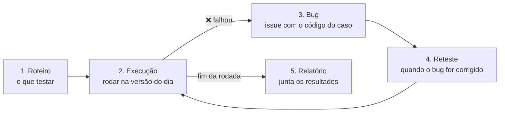

# 🧪 Testes manuais do CANTEIRO

Os testes automáticos (JUnit e Vitest) conferem as regras por dentro do código. Esta pasta cuida do resto: **o que só uma pessoa jogando consegue conferir**. Ela tem os roteiros de teste, o registro de cada rodada de execução, as sessões com jogadores e o relatório final.

Tudo aqui é Markdown e pode ser feito **pelo site do GitHub**, sem programar nem instalar o Git.

## O que tem aqui

| Arquivo | Para que serve |
|---|---|
| [`roteiros/`](roteiros/) | Um arquivo por caso de teste: o que fazer e o que deve acontecer. Comece pelo [`MODELO.md`](roteiros/MODELO.md) e pelos três exemplos prontos |
| [`execucoes/`](execucoes/) | Uma rodada de testes por arquivo: a data, a versão do jogo e o resultado de cada caso. Modelo em [`execucoes/MODELO.md`](execucoes/MODELO.md) |
| [`sessoes/`](sessoes/) | As sessões com pessoas de fora do grupo (#30), com o roteiro da observação e o questionário |
| [`RELATORIO.md`](RELATORIO.md) | O documento final com os resultados, que vai para a entrega |

## O ciclo

1. **Roteiro.** Cada critério de aceitação vira um caso de teste, com um código como `CT-RF17-01`: **CT** de caso de teste, o **requisito** que ele confere e um **número**. O roteiro tem a pré-condição, os passos numerados e o resultado esperado de cada passo.
2. **Execução.** A cada entrega, copie o modelo de execução, anote **qual versão** você testou e rode os roteiros, marcando cada caso:

   | Marca | Quer dizer |
   |---|---|
   | ✅ | Passou: tudo aconteceu como o roteiro diz |
   | ❌ | Falhou: algo diferente do esperado. **Vira um bug** |
   | ⚠️ | Bloqueado: não deu para testar (outro bug impediu, falta a funcionalidade). Diga o motivo |
   | ➖ | Não se aplica nesta versão |

3. **Bug.** Todo ❌ vira uma issue pelo modelo **🐛 Bug** (aba Issues → *New issue*). No título, o código do caso: `CT-RF21-02: ranking aceita nome vazio`. **Sempre com print ou vídeo curto.** Anote o número da issue na execução.
4. **Reteste.** Quando o bug for corrigido (a issue fecha), rode de novo aquele caso **e os vizinhos** da mesma tela: uma correção às vezes quebra outra coisa.
5. **Relatório.** No fim de cada rodada, atualize o [`RELATORIO.md`](RELATORIO.md) com os números e os bugs.

## Como testar com eficiência

- **Comece pelo que mais pesa.** Primeiro os requisitos essenciais e a mecânica de estabilidade e colapso, que é o diferencial do jogo. Depois o resto. A tabela abaixo já está em ordem de prioridade.
- **Teste também o caminho errado.** É lá que os bugs moram: apertar tecla na borda do tabuleiro, nome vazio no ranking, fechar a aba no meio da partida, cair a internet.
- **Um roteiro, uma coisa.** Se um caso confere três coisas e uma falha, ninguém sabe qual. Melhor três casos curtos.
- **Escreva para quem nunca viu o jogo.** O roteiro está bom quando um colega consegue seguir sem perguntar nada.
- **Sessões exploratórias.** Além dos roteiros, faça de vez em quando 30 minutos de teste livre com um objetivo, como "tentar quebrar o ranking" ou "jogar só com o teclado". Anote o que achou na execução, como um caso `EXP-01`.
- **Evidência sempre.** Print ou vídeo em todo ❌. No Windows, `Win + Shift + S` tira print de um pedaço da tela.

## Onde testar

| Versão | Como abrir | Quando usar |
|---|---|---|
| **Online** | [canteiro.digitalcodexa.com](https://canteiro.digitalcodexa.com). Na rede da UFLA, use [canteiro.onrender.com](https://canteiro.onrender.com) | O jeito mais rápido. Atualiza sozinha a cada merge na `develop`. **O ranking online zera a cada atualização**: para testar se o ranking continua depois de fechar o jogo, use o JAR |
| **JAR** | Em [Actions → CI](https://github.com/mateus-vitor-ferreira-dev/canteiro/actions/workflows/ci.yml), abra a execução verde mais recente da `develop` e baixe o **`canteiro-jar`** em *Artifacts*. Dois cliques no `canteiro.jar` (precisa do Java 17) | A versão que é entregue. Obrigatória para os casos de arquivo (ranking, configurações) e de "dois cliques" |

Na execução, anote sempre **qual das duas** e, no JAR, o link da execução do CI de onde ele veio.

## O que precisa de roteiro

Os critérios de aceitação que só dá para conferir à mão, em ordem de prioridade. O código sugerido já está na tabela; os três primeiros já têm roteiro pronto como exemplo.

| Prioridade | Caso | Requisito | O que conferir | Roteiro |
|---|---|---|---|---|
| 🔴 | `CT-RF17-01` | RF16, RF17 | Empilhar peças de um lado só faz a estrutura desabar, com aviso antes | [pronto](roteiros/CT-RF17-colapso.md) |
| 🔴 | `CT-RF21-01` a `03` | RF21, RF22 | Salvar o nome no ranking, recusar nome inválido e o ranking continuar lá depois de fechar o jogo | [pronto](roteiros/CT-RF21-ranking.md) |
| 🔴 | `CT-RF30-01`, `CT-RF31-01` e `02` | RF30, RF31 | Pausar ao trocar de aba, reconectar quando a internet volta e avisar quando o servidor reinicia | [pronto](roteiros/CT-RF30-reconexao.md) |
| 🔴 | `CT-RF07-01` | RF07, RF08, RF09 | Mover, girar e derrubar a peça, inclusive encostada nas paredes | a escrever |
| 🔴 | `CT-RF15-01` | RF14, RF15 | O índice de estabilidade muda no mesmo instante em que a peça é fixada | a escrever |
| 🔴 | `CT-RF12-01` | RF12, RF13, RF18 | Fechar linhas dá pontos, e 10 linhas sobem de nível | a escrever |
| 🔴 | `CT-RF20-01` | RF20 | A partida acaba e a tela de resultado mostra pontuação, nível, linhas, colapsos e tempo | a escrever |
| 🟡 | `CT-RF29-01` | RF29, RNF04 | Dois cliques no JAR abrem o jogo no navegador em até 3 segundos, no Windows, no Linux e no macOS | a escrever |
| 🟡 | `CT-RF19-01` | RF19, RNF05 | Pausar e retomar com P ou Esc; a legenda das teclas está sempre visível | a escrever |
| 🟡 | `CT-RF27-01` | RF27 | Trocar uma tecla nas configurações vale na partida e na legenda | a escrever |
| 🟡 | `CT-RF28-01` | RF28 | Sons ao fixar peça, fechar linha e desabar; a tecla M liga e desliga | a escrever |
| 🟡 | `CT-RNF06-01` | RNF06 | Os quatro materiais se distinguem pela textura, sem depender da cor | a escrever |
| 🟢 | `CT-RNF16-01` | RNF16 | O JAR roda numa máquina sem Node.js | a escrever |
| 🟢 | `CT-RNF13-01` | RNF13 | Outro computador da mesma rede **não** consegue abrir o jogo que está rodando pelo JAR | a escrever |
| 🟢 | `CT-UI-01` | — | Navegar por todas as telas e voltar ao menu, com o teclado e com o mouse | a escrever |

As funcionalidades que ainda estão sendo feitas (repetições #35, relatório #70, modo treino #37) entram na tabela quando ficarem prontas. Até lá, os casos delas são ⚠️ bloqueados.
